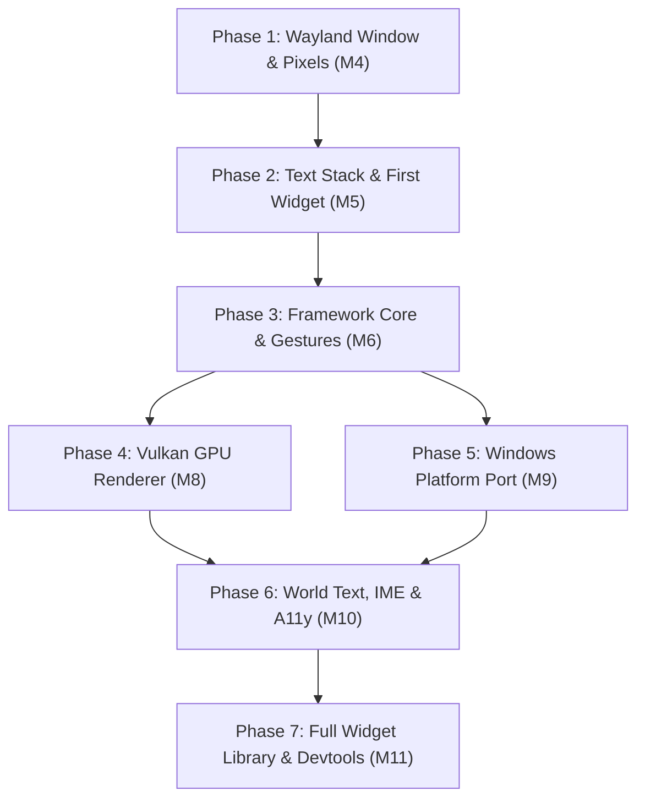

# Yerux GUI Technical Implementation Plan (M4–M11)

Status: Architectural specification and technical execution plan for the native Yerux GUI framework and rendering engine.
Scope: Linux Wayland, software rasterizer, TrueType text stack, reactive widget system, Vulkan GPU acceleration, and cross-platform expansion.

---

## 1. Executive Summary & Principles

The goal is to build a Flutter-grade, high-performance UI framework written natively in Yerux, without depending on external C runtime engines like Skia, SDL, GLFW, or HarfBuzz.

### Core Architectural Decisions:
1. **Decoupled Display List**: The UI framework records rendering intents into an immutable, serializable `DisplayList` (draw ops, clips, transforms, paints). Widgets never touch rasterizer or GPU code directly.
2. **Software-First Presentation (No FFI on Linux)**: Linux Wayland presents CPU buffers directly via raw syscalls (`memfd_create`, `ftruncate`, `mmap`, Unix sockets with `SCM_RIGHTS`). This ensures a completely functional window and 2D canvas without needing C libraries, dynamic linkers, or GPU drivers.
3. **GPU as an Acceleration Tier (Impeller Design)**: Vulkan rendering acts as an alternative backend consuming the identical `DisplayList`. It uses a fixed set of precompiled AOT SPIR-V shaders with SDF (Signed Distance Fields) for UI primitives to eliminate runtime shader compilation jank.
4. **Fine-Grained Reactive Signals**: Following `docs/SIGNALS.md`, state management avoids full-tree rebuild and diffing allocations. `Signal<T>`, `Derived<T>`, and `Effect` use generational `Copy` handles into a runtime-owned reactive graph, updating in $O(\text{affected nodes})$ with glitch-free topological propagation.
5. **Incremental Verification by Demos**: Every stage culminates in an interactive demo validated with golden-image regression tests in CI (e.g. headless Weston for Wayland).

---

## 2. Platform Layer: Wayland Wire Client

Rather than linking `libwayland-client.so`, Yerux speaks the Wayland wire protocol directly over Unix domain sockets.

### 2.1 Protocol Transport & Encoding
- **Socket Endpoint**: Connects to `AF_UNIX` stream socket at `$XDG_RUNTIME_DIR/$WAYLAND_DISPLAY` (falling back to `wayland-0`).
- **Framing Format**: All values are 32-bit words in host endianness:
  - Header: 32-bit `object_id`, followed by `(message_size << 16) | opcode`.
  - Arguments: 32-bit signed/unsigned ints, fixed-point 24.8 coordinates, NUL-padded string blocks, and new object IDs.
- **File Descriptor Passing**: Carried through `sendmsg`/`recvmsg` ancillary data (`msg_control` with `SOL_SOCKET`, `SCM_RIGHTS`).

### 2.2 Core Interface Set
1. `wl_display` (object 1): Connection sync (`get_registry`, `sync`, error events).
2. `wl_registry`: Dynamic discovery of compositor globals and version negotiation.
3. `wl_compositor` & `wl_surface`: Window surface allocation, buffer attachment, surface commits, and `damage_buffer`.
4. `wl_shm` & `wl_shm_pool`: Shared-memory pixel buffer management (`WL_SHM_FORMAT_XRGB8888`, `ARGB8888`).
5. `xdg_wm_base`, `xdg_surface`, `xdg_toplevel`: Desktop surface lifecycles, ping/pong heartbeats, window state (`configure`, `ack_configure`), min/max sizing, and close requests.
6. `zxdg_decoration_manager_v1`: Request server-side decorations (SSD). When compositors like GNOME refuse SSD, the framework draws custom client-side decorations (CSD).
7. `wl_seat`, `wl_pointer`, `wl_keyboard`: Pointer motion, enter/leave, button clicks, axis scroll; keyboard keymaps transferred via memfd file descriptor with modifier state tracking.
8. `wl_surface.frame` / `wp_presentation`: Pacing frame commits to display refresh rate (vsync).

### 2.3 Buffer Exchange Pipeline
```
[ Yerux UI Loop ] -> Paints pixels into mmap'd memfd (ARGB8888)
       |
  (SCM_RIGHTS)    -> Passes memfd to compositor via wl_shm_pool
       |
[ Compositor ]    -> Maps pool, binds wl_buffer, composite to output display
```

---

## 3. Text Stack

Text is the largest single time sink in UI rendering. We adopt a staged capability ladder:

### 3.1 TrueType/OpenType Engine (Phase 1: Latin/Cyrillic/Greek)
- **Font Parsing (`std.font`)**: Mechanical parser for OpenType/TTF tables:
  - `head`, `maxp`, `hhea`, `hmtx`: Metrics, bounding boxes, advance widths, ascent/descent.
  - `cmap` (format 4 and format 12): Unicode scalar to Glyph ID mapping.
  - `loca`, `glyf`: Simple and composite glyph contour decomposition.
  - `kern` / `GPOS`: Basic pair kerning adjustments.
- **Analytic Scanline Rasterizer**: Signed area accumulation per scanline with prefix-sum integration (similar to `font-rs`), providing smooth subpixel anti-aliasing without runtime hinting overhead.
- **LRU Glyph Cache & Atlas**:
  - CPU: Cache of rendered bitmap masks keyed by `(font_id, glyph_id, subpixel_bin, font_size)`.
  - GPU: Dynamic texture atlas page (e.g. 1024x1024 A8 / R8 format) streaming glyph masks into device-local memory.

### 3.2 Layout & Paragraph Formatting (Phase 2)
- **Unicode Segmentation**: Line-breaking opportunities based on UAX #14; grapheme clustering on UAX #29.
- **Paragraph Layout**:
  - Rich text span tree (`TextStyle { font, size, weight, color, background }`).
  - Word wrapping, hyphenation points, ellipsis truncation (`TextOverflow.Ellipsis`).
  - Text metrics calculation for box constraints: `compute_min_intrinsic_width`, `compute_max_intrinsic_width`, and `compute_layout(constraints)`.
  - Cursor hit-testing: Coordinate $(x, y) \to \text{byte offset}$, selection bounding rects, and caret geometry.

### 3.3 Complex Shaping & World Scripts (Phase 3)
- OpenType GSUB/GPOS substitution engines: Ligature resolution, mark-to-base and mark-to-mark attachment.
- Directionality (UAX #9): Bidirectional run itemization and visual reordering for Arabic and Hebrew.
- Platform delegation option: DirectWrite on Windows, CoreText on macOS, allowing complete world script coverage on desktop OSes.

---

## 4. Widget Architecture & Reactivity

### 4.1 Fine-Grained Reactive Runtime
Unlike React or Flutter which rebuild and diff widget/element subtrees on every state change, Yerux utilizes the reactive graph defined in `docs/SIGNALS.md`:
- `Signal<T>`: Holds mutable application state.
- `Derived<T>`: Pure computed values cached with version verification and early-cutoff optimization.
- `Effect`: Dispatched automatically when tracked dependencies update.
- **Zero Memory Aliasing**: Signal handles are 64-bit `Copy` values (`index: UInt32, generation: UInt32`). Actual payload data lives inside the centralized UI runtime graph.
- Updates operate in $O(\text{affected nodes})$, driving targeted leaf repaints and precise layout invalidations.

### 4.2 Three-Tree Architecture
```
Widget Tree (Immutable Configuration)
    ↓ instantiates
Element Tree (Lifecycle & Reactive Subscriptions)
    ↓ creates & updates
RenderObject Tree (Box Constraints, Sizing, Painting to DisplayList)
```

1. **Box Constraints Layout Protocol**:
   - One-pass $O(n)$ layout traversal: Parent passes `BoxConstraints(min_w, max_w, min_h, max_h)`; child returns `Size(w, h)`; parent assigns child offset.
2. **DisplayList Recording**:
   - `RenderObject.paint(context)` emits draw calls to a `DisplayListRecorder`:
     - `draw_rect`, `draw_rrect`, `draw_circle`, `draw_path`, `draw_text_blob`, `draw_image`.
     - `push_clip_rect`, `push_opacity`, `push_transform`, `pop`.
3. **Core Widget Library**:
   - **Layout**: `Padding`, `Center`, `Align`, `SizedBox`, `Row`, `Column`, `Stack`, `Positioned`, `Flex`, `Expanded`.
   - **Display**: `Text`, `Image`, `Icon`, `CustomPaint`, `DecoratedBox`.
   - **Interactive**: `GestureDetector` (pointer down/up/move/cancel, tap, drag, arena disambiguation), `Button`, `Checkbox`, `Switch`, `Slider`.
   - **Text Editing**: `TextField` with caret rendering, selection highlight, double-click word selection, clipboard copy/paste, and IME composing decoration.
   - **Collections**: `ListView.builder` driven by `ListSignal<T>` with virtualized sliver recycling for infinite or 10,000+ element lists.

---

## 5. GPU Acceleration (Vulkan RHI & Renderer)

### 5.1 Dynamic Linking via FFI
- Linux native builds utilize eager ELF dynamic linking (as specified in `docs/FFI.md`):
  - Executable links `libc.so.6` dynamically (`PT_INTERP /lib64/ld-linux-x86-64.so.2`).
  - Calls `dlopen("libvulkan.so.1", RTLD_NOW)` and `dlsym("vkGetInstanceProcAddr")`.
  - If Vulkan is unavailable on the system, the application degrades gracefully to the software rasterizer.

### 5.2 Vulkan Render Hardware Interface (RHI)
- **Core Abstractions**:
  - `Instance`, `PhysicalDevice`, `Device`, `Queue`.
  - `SurfaceKHR` (created via `VK_KHR_wayland_surface`).
  - `SwapchainKHR` with double/triple buffering, handling window resize events (`VK_ERROR_OUT_OF_DATE_KHR`).
  - `GpuBuffer` (Device-local vertex/index buffers and host-visible staging buffers).
  - Sub-allocator: Block-based memory sub-allocation to operate within OS device allocation limits (Vulkan max allocation counts).

### 5.3 Impeller-Style Shader Strategy
- **AOT Precompiled SPIR-V**: Shaders are compiled during toolchain build; no runtime shader compiler (no shader compilation stutter).
- **SDF UI Shaders**: Specialized fragment shaders evaluate distance functions directly for rects, rounded corners, pill shapes, borders, and drop shadows with analytical anti-aliasing.
- **Vector Path Rendering**:
  - Convex/Simple Paths: CPU triangulation / ear-clipping into vertex buffers.
  - Complex Concave Paths: Stencil-then-cover technique using an intermediate stencil buffer.
- **Glyph Atlas Pipeline**: Single-channel R8 texture atlas updated via staged transfers; vertex shader instances glyph quads with UV coordinates.

---

## 6. Required Stdlib and System Interfaces

| Layer | Module / Syscall | Purpose | Status in Yerux |
|---|---|---|---|
| **OS Syscalls** | `socket(AF_UNIX)`, `sendmsg`, `recvmsg` | Wayland protocol socket communication and `SCM_RIGHTS` fd passing | Supported via raw syscalls |
| **Memory IPC** | `memfd_create`, `ftruncate`, `mmap`, `munmap` | Zero-copy shared memory pixel buffers (`wl_shm`) | Available in native x86-64 Linux |
| **Event Loop** | `epoll_create1`, `epoll_ctl`, `epoll_wait`, `timerfd` | Non-blocking event loop multiplexing Wayland events and timers | Extends `std.process`/`std.net` loop |
| **Protocol** | `std.wayland` | Wire codec, interface dispatch, protocol generators | To be implemented in Yerux |
| **Geometry** | `std.graphics` | `Point`, `Size`, `Rect`, `RRect`, `Color`, `Matrix2D`, `Path`, `DisplayList` | To be implemented in Yerux |
| **Font Engine** | `std.font` | TrueType parser, glyph rasterizer, LRU cache | To be implemented in Yerux |
| **UI Framework** | `std.ui` | Signals reactive graph, widgets, box layout, gesture arena | To be implemented in Yerux |
| **Dynamic FFI** | `std.ffi` (`dlopen`, `dlsym`) | Loading `libvulkan.so.1` at runtime for GPU presentation | Native dynamic ELF in place |

---

## 7. Phased Implementation Roadmap



### Phase 1: Native Wayland Window & Software Pixels (Roadmap M4)
- **Goal**: Open a native Wayland window, draw solid/procedural color patterns into shared memory, handle resizes and pings.
- **Deliverables**:
  - Raw Unix domain socket connection to `$WAYLAND_DISPLAY`.
  - Handshake and registry negotiation for `wl_compositor`, `wl_shm`, `xdg_wm_base`.
  - `memfd_create` buffer allocation and presentation.
  - Event loop responding to `xdg_wm_base.ping` and `xdg_surface.configure`.
- **Validation Demo**: `examples/gui/01_window.yx` opening a solid window that resizes smoothly and closes cleanly; headless Weston CI tests with pixel golden verification.
- **Estimated Effort**: 3–5 person-months.

### Phase 2: Software Text Engine & Counter Widget (Roadmap M5)
- **Goal**: Display crisp anti-aliased text and an interactive button.
- **Deliverables**:
  - `std.font`: TrueType table parser (`cmap`, `glyf`, `hmtx`, `loca`).
  - Scanline analytic rasterizer with alpha blending onto CPU surface.
  - Memory glyph cache.
  - Initial `DisplayList` recorder and CPU painter.
  - Box-constraint layout core (`SizedBox`, `Padding`, `Center`, `Row`, `Column`).
  - `wl_seat` pointer events (mouse movement, button click).
- **Validation Demo**: `examples/gui/02_counter.yx` displaying a clickable button that increments a text label; visual regression tests in CI.
- **Estimated Effort**: 6–9 person-months.

### Phase 3: Framework Core, Reactive State & Text Editing (Roadmap M6)
- **Goal**: Full UI framework core with signal-driven reactivity, scrolling, and keyboard text entry.
- **Deliverables**:
  - Reactive runtime integration (`signal`, `derived`, `effect`) powering widget properties (`Prop<T>`).
  - Keyboard input handling: `wl_keyboard` keymap mapping, modifier tracking.
  - `TextField` widget with caret blink, selection dragging, and backspace/enter processing.
  - Scrollable view with clipping and touch/mouse-wheel scroll physics.
  - Fast Hot Restart via process re-execution and state serialization.
  - X11 fallback protocol implementation (`/tmp/.X11-unix/X0`).
- **Validation Demo**: `examples/gui/03_todo.yx` interactive task manager with input field, checkboxes, and scrollable list.
- **Estimated Effort**: 8–12 person-months.

### Phase 4: Vulkan GPU Renderer (Roadmap M8)
- **Goal**: Hardware-accelerated 60–120 fps rendering consuming the existing `DisplayList`.
- **Deliverables**:
  - Dynamic ELF FFI binding to `libvulkan.so.1`.
  - Vulkan device, swapchain (`VK_KHR_wayland_surface`), command buffer recording.
  - AOT SPIR-V shader suite (SDF rects/rrects/circles/shadows, path stencil/cover).
  - GPU texture atlas for text glyphs.
  - Partial damage presentation (`damage_buffer`).
- **Validation Demo**: `examples/gui/04_gpu_benchmark.yx` rendering 5,000 animated cards/rectangles at a stable 120 fps.
- **Estimated Effort**: 10–14 person-months.

### Phase 5: Second Platform: Windows (Roadmap M9)
- **Goal**: Native desktop execution on Windows using Win32 and Vulkan/DIB.
- **Deliverables**:
  - PE executable format integration with `.pdata` and Win64 calling conventions.
  - Win32 message loop (`CreateWindowExW`, `GetMessageW`, `DispatchMessageW`, `WndProc`).
  - CPU presentation via `StretchDIBits` and GPU presentation via `VK_KHR_win32_surface`.
- **Validation Demo**: The identical `03_todo.yx` application running natively on Windows without source modifications.
- **Estimated Effort**: 8–12 person-months.

### Phase 6: World Text, IME & Accessibility (Roadmap M10)
- **Goal**: High-fidelity internationalization, input method editors, and assistive technology support.
- **Deliverables**:
  - Bi-directional text layout (UAX #9) and complex script shaping (GSUB/GPOS for Arabic, Hebrew).
  - Wayland `text-input-v3` / Windows TSF for CJK IME composition overlays.
  - Accessibility semantics tree exposed to Linux AT-SPI over D-Bus and Windows UI Automation.
- **Validation Demo**: Multilingual text editor handling Arabic RTL, Japanese IME input, and screen-reader accessibility tests.
- **Estimated Effort**: 15–25 person-months.

### Phase 7: Comprehensive Widget Library & Devtools (Roadmap M11)
- **Goal**: Complete, cohesive design system with rich components and debugging tools.
- **Deliverables**:
  - Standard widget suite (~50-80 components: tabs, dialogs, sliders, menus, date pickers, virtual tables).
  - Embedded image decoders: PNG, JPEG, GIF, and WebP.
  - In-app DevTools: Widget tree inspector, paint bounds visualizer, and frame performance overlay.
  - Relocatable module hot-reload mechanism.
- **Validation Demo**: A complete desktop markdown notes application or vector graphics viewer.
- **Estimated Effort**: 20–30 person-months.

---

## 8. Summary of Estimates and Milestones

| Milestone | Scope / Deliverable | Key Tech | Effort (pm) | Gate / Demo |
|---|---|---|---|---|
| **M4** | Window + Pixels | Wayland wire protocol, `memfd`, `SCM_RIGHTS` | 3–5 pm | Solid window opens/resizes in Weston CI |
| **M5** | Text & Simple Widgets | TrueType parser, analytic rasterizer, layout | 6–9 pm | Counter app with text and clickable button |
| **M6** | Framework Core & Reactivity | Signals graph, `TextField`, scrolling, X11 | 8–12 pm | Todo app with text entry and list scroll |
| **M8** | GPU Acceleration | Vulkan RHI via dlopen, AOT SPIR-V, SDF shaders | 10–14 pm | 60–120 fps animated benchmark |
| **M9** | Windows Platform | Win32 message loop, PE writer, Win64 ABI | 8–12 pm | Same Todo app running on Windows |
| **M10** | World Text, IME & A11y | Bidi (UAX 9), GSUB/GPOS shaping, `text-input-v3` | 15–25 pm | Multilingual editor with IME & screen reader |
| **M11** | Widget Suite & Devtools | 60+ widgets, image codecs, inspector | 20–30 pm | Full desktop productivity app |
| **Total** | **End-to-end framework** | | **70–107 pm** | Production-ready cross-platform UI engine |
